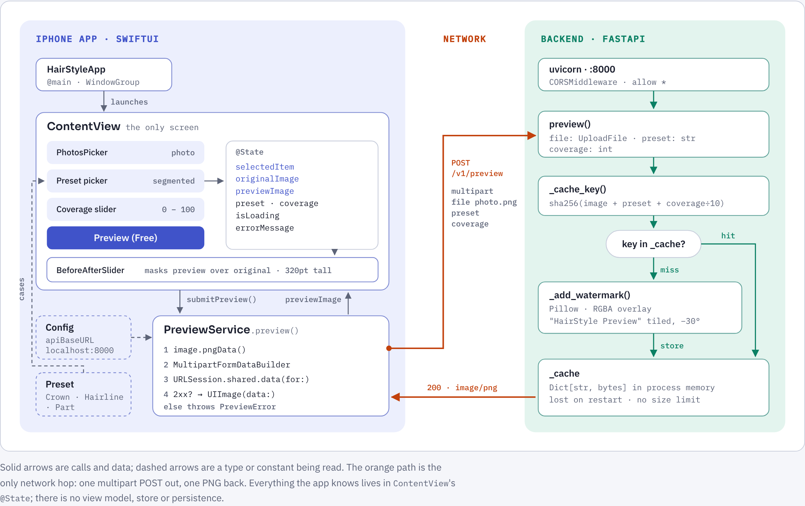

# Architecture diagram

How the HairStyle SwiftUI app, `PreviewService` and the FastAPI `/v1/preview` backend fit together.

<picture>
  <source media="(prefers-color-scheme: dark)" srcset="architecture-dark.png">
  
</picture>

Solid arrows are calls and data; dashed arrows are a type or constant being read. The orange path is the only network hop: one multipart POST out, one PNG back.

## Files

- `hairstyle-architecture.html` — the full page: the diagram, a step-by-step walkthrough of one preview, a file map, and current caveats. Open it in a browser (works offline except for web fonts; follows light/dark mode).
- `architecture.png` / `architecture-dark.png` — the diagram as images, light and dark.

Drawn from the code on `main` as of 25 Nov 2026. If the app's structure changes, update the HTML and re-export the PNGs.
